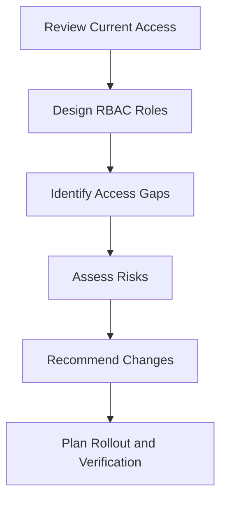

# 01 — Billing Access Review: Scope
Project: Northwind Health | Billing RBAC  
Document Reference: IAM-RBAC-01-SC  
Version: 1.0  
Status: Draft — Portfolio Case Study  
Classification: Public — Fictional Data  

# 1. Scenario
Northwind Health is reviewing billing-system access for six employees. 
The goal is to ensure permissions match job responsibilities and reduce the risk of financial fraud, errors, 
and unnecessary access.

# 2. Objectives

- Design roles using least privilege.
- Identify excessive access and conflicting permissions.
- Assess risks and business impact.
- Plan access changes without disrupting billing operations.

# 3. Scope
| Area | In Scope |
|---|---|
| Users | Ana, Ben, Chloe, Dev, Erin, and Fraser |
| Permissions | Invoices, refunds, billing details, payees, payments, data exports, and system administration |
| Role Design | Billing Clerk, Billing Supervisor, Finance Manager, and IT Support |
| Risk Review | Excessive access, segregation of duties, and privileged access |
| Remediation | Access changes, rollout, and verification |

_Create New Payee remains unassigned until its business need is confirmed._

# 5. Assessment Workflow

---
Next Document: 02-rbac-role-design-and-access-gap.md
