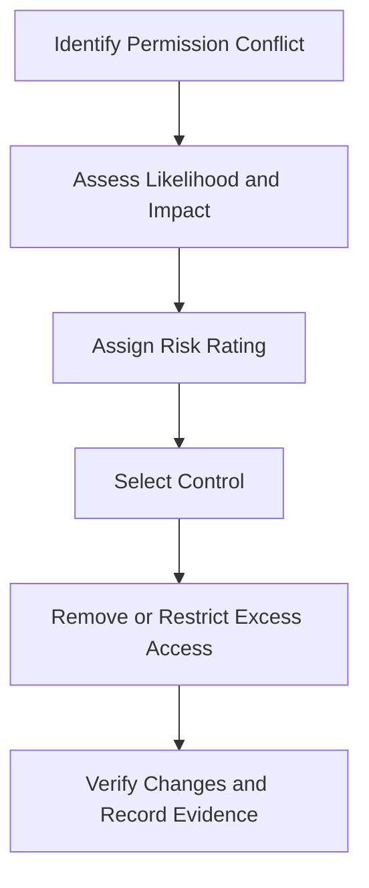

# 03 — Access Risk and Segregation of Duties
Project: Northwind Health | Billing Access Review  
Document Reference: IAM-RBAC-03-RM  
Version: 1.0  
Status: Draft — Portfolio Case Study  
Classification: Public — Fictional Data  

# 1. Risk Assessment Methodology
Risks are assessed based on the likelihood of misuse or error and the potential business impact.
| Score | Likelihood | Business Impact |
|---|---|---|
| 1 | Unlikely | Limited disruption or loss. |
| 2 | Possible | Financial loss or significant operational disruption. |
| 3 | Likely | Severe financial impact, fraud, or exposure of sensitive data. |

Risk Score = Likelihood × Impact

| Score | Risk Rating |
|---|---|
| 1–2 | Low |
| 3–4 | Medium |
| 6 | High |
| 9 | Critical |

# 2. Segregation of Duties (SoD)
Segregation of duties separates sensitive activities so one person cannot complete a potentially fraudulent transaction 
without independent oversight.

| Conflicting Permissions | Current Holder(s) | Risk | Recommended Control |
|---|---|---|---|
| Create New Payee + Approve Payments | Dev, Fraser | Could allow someone to add a fraudulent payee and approve payments to them. | Separate payee creation from payment approval. Leave payee creation unassigned until a business need is confirmed. |
| Create Invoices + Approve Payments | Dev, Fraser | Could allow someone to create false invoices and approve their payment. | Limit invoice creation to billing staff and payment approval to the Finance Manager role. |
| System Administration + Financial Permissions | Fraser | Combining IT administration with financial access increases the risk of misuse and reduces independent oversight. | Remove permanent financial access. Provide approved, temporary access only when troubleshooting requires it. |
| Edit Billing Details + Approve Refunds | Ben, Dev, Fraser | Someone could change billing details and approve a related refund without independent review. | Restrict access according to role requirements and require independent review of refunds where needed. |

# 3. Risk Prioritization

| Priority | Account(s) | Reason |
|---|---|---|
| High | Fraser | Holds financial permissions alongside system administration. |
| High | Dev | Can create invoices, create payees, and approve payments beyond the Billing Supervisor's stated requirements. |
| Review Required | Ben | Has refund approval and payee creation permissions not specified for a Billing Clerk. Confirm business requirements and workflows before determining whether a direct SoD conflict exists. |

# 4. Risk Treatment Workflow

---
Next Document: 04-user-access-findings-and-risk-register.md
