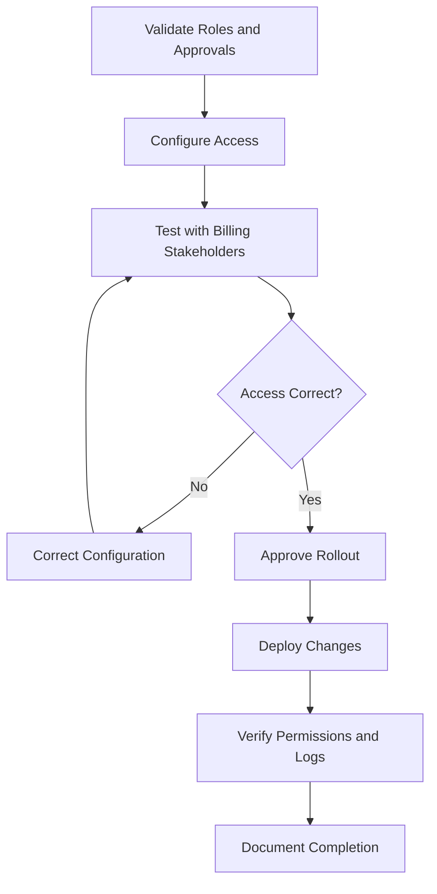

# 05 — Remediation, Rollout and Controls
Project: Northwind Health | Billing Access Review  
Document Reference: IAM-RBAC-05-RC  
Version: 1.0  
Status: Draft — Portfolio Case Study  
Classification: Public — Fictional Data  

## 1. Rollout Plan

| Phase | Action | Expected Outcome |
|---|---|---|
| 1. Validate | Confirm the proposed roles, permissions, business approvals, and access requirements. | Approved access model. |
| 2. Implement | Configure roles, remove excess permissions, and test changes with billing stakeholders. | Access aligned with job responsibilities without disrupting operations. |
| 3. Verify | Test permissions, review access logs, resolve exceptions, and document approval. | Verified access changes and evidence of completion. |

## 2. Preventive Controls

| Control | Purpose |
|---|---|
| Role-Based Access Control (RBAC) | Assign permissions through approved job roles. |
| Least Privilege | Limit access to what each role requires. |
| Segregation of Duties | Separate conflicting financial activities. |
| Periodic Access Reviews | Confirm permissions remain appropriate as responsibilities change. |
| Access Logging | Support accountability and investigation of financial actions. |

## 3. Fraser's Temporary Administrative Access
Fraser should retain system administration but have no permanent financial permissions.
When additional access is necessary to resolve a technical issue:
- Require an approved support request and defined business justification.
- Grant only the permissions needed, for a limited period.
- Log the activity and review it after the task.
- Revoke temporary permissions when the work is complete.

## 4. Rollout Workflow

## 5. Success Criteria
- Each employee has access appropriate to their approved role.
- Excess permissions and conflicting financial access are removed.
- Billing operations continue without avoidable disruption.
- Fraser's temporary elevated access is approved, logged, and time-limited.
- Changes are tested and supported by documented verification evidence.
